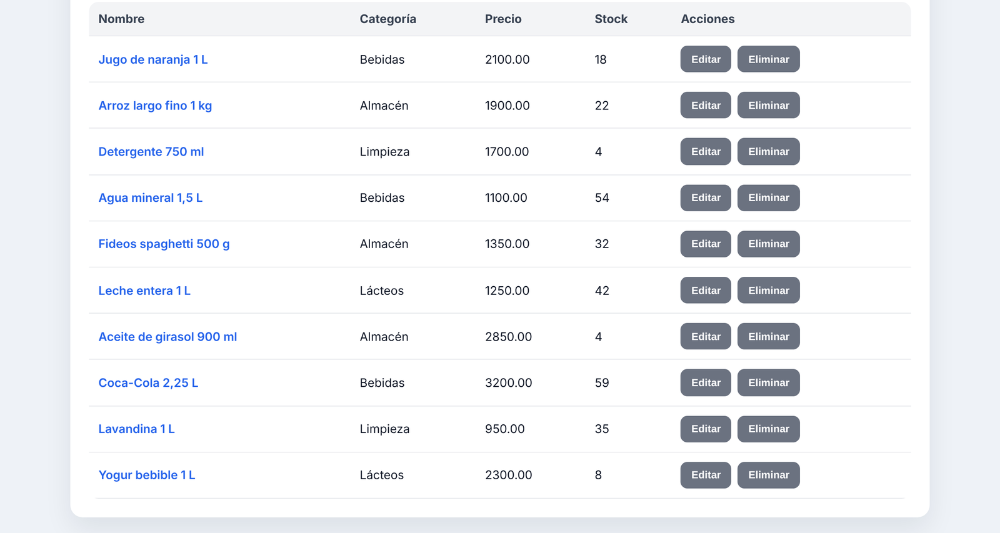
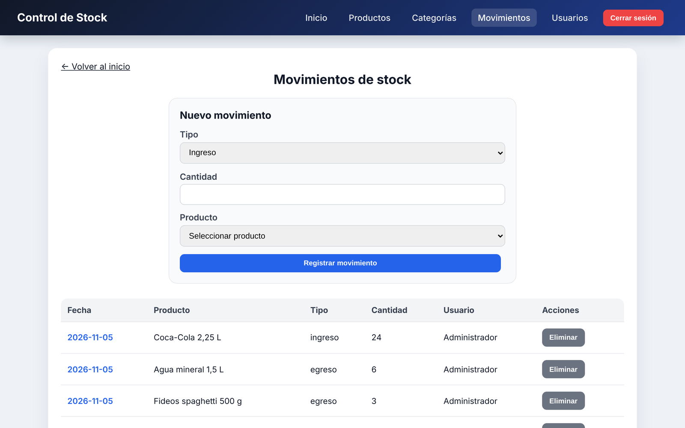
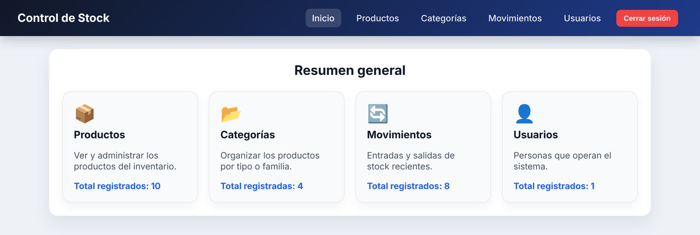

# Sistema de Inventario y Control de Stock

[](https://github.com/MarianoMuri/api-control-stock/actions/workflows/ci.yml)

**🚀 Demo en vivo:** https://inventory-control-z7uw.onrender.com  
Usuario de prueba: `admin@test.com` / `admin123`  
<sub>Alojado en el plan gratuito de Render: si nadie lo usó en un rato, la primera carga puede tardar hasta un minuto mientras la API despierta.</sub>

Aplicación web full stack para gestionar inventario: productos, categorías, movimientos de stock y usuarios con roles.

**Stack:** Node.js · Express · PostgreSQL · Sequelize · JWT · React · Vite · Vitest · Swagger · Docker

> **English summary:** Full-stack inventory management system. REST API built with Node.js, Express and PostgreSQL (Sequelize ORM), with JWT authentication, role-based authorization, Joi validation and Swagger docs. React frontend with protected routes, CRUD screens and a dashboard, tested with Vitest and React Testing Library. Runs locally or with Docker Compose.

Proyecto Final Integrador de la Tecnicatura Universitaria en Programación (UTN).

## Capturas

**Listado de productos** con categoría, precio y stock:



**Movimientos de stock:** cada ingreso o egreso actualiza el stock del producto y queda registrado con fecha y usuario.



**Resumen general** al iniciar sesión:



---

# 1. Tecnologías utilizadas

## Backend

* Node.js
* Express
* PostgreSQL
* Sequelize ORM
* JWT (JSON Web Token)
* Bcrypt
* Joi
* Dotenv
* Cors
* Swagger
* Docker
* Docker Compose

## Frontend

* React
* React Router DOM
* Vite
* Fetch API
* LocalStorage
* CSS
* Vitest
* React Testing Library

## Herramientas de apoyo

* Git
* GitHub
* GitHub Projects
* Thunder Client
* Postman

---

# 2. Instalación y ejecución

## Opción A: Docker (recomendada)

```bash
cp .env.example .env
# Editá .env y completá POSTGRES_PASSWORD y JWT_SECRET
docker compose up --build
```

La API queda en `http://localhost:3000` y la documentación Swagger en `http://localhost:3000/api-docs`.

## Opción B: Local

### Backend

Requiere Node.js 20+ y PostgreSQL con una base `control_stock` creada.

```bash
cd backend
npm install
cp .env.example .env
# Editá .env: datos de tu PostgreSQL y JWT_SECRET (obligatorio)
npm run dev
```

Al iniciar, el servidor crea las tablas automáticamente (`sequelize.sync`) y el usuario administrador si no existe. Si falta `JWT_SECRET`, el servidor no arranca.

Servidor disponible en `http://localhost:3000`. Swagger en `http://localhost:3000/api-docs`.

### Frontend

```bash
cd frontend
npm install
cp .env.example .env
npm run dev
```

Frontend disponible en `http://localhost:5173`.

## Usuario administrador inicial

| Campo | Valor por defecto |
|---|---|
| Email | `admin@test.com` |
| Contraseña | `admin123` |
| Rol | `master` |

Se pueden cambiar con las variables `ADMIN_EMAIL` y `ADMIN_PASSWORD` antes del primer inicio.

---

# 3. Estructura del proyecto

```text
backend/
├── config/
├── controllers/
├── middleware/
├── migrations/
├── models/
├── routes/
├── services/
├── swagger/
└── app.js

frontend/
├── src/
│   ├── components/
│   ├── pages/
│   ├── services/
│   ├── tests/
│   ├── App.jsx
│   └── main.jsx
└── public/

docs/
├── sprint1.md
├── sprint2.md
└── tests-integracion-frontend-backend.md
```

---

# 4. Funcionalidades implementadas

## Autenticación

✔ Login mediante JWT

✔ Protección de rutas privadas

✔ Persistencia de sesión

✔ Logout

✔ Gestión de usuarios autenticados

---

## Gestión de Productos

✔ Alta de productos

✔ Modificación de productos

✔ Eliminación de productos

✔ Consulta de detalle

✔ Asociación a categorías

✔ Gestión de stock

---

## Gestión de Categorías

✔ Alta de categorías

✔ Modificación de categorías

✔ Eliminación de categorías

✔ Consulta de detalle

✔ Gestión de descripción

---

## Gestión de Usuarios

✔ Alta de usuarios

✔ Modificación de usuarios

✔ Eliminación de usuarios

✔ Consulta de detalle

✔ Gestión de roles

✔ Gestión de credenciales

---

## Gestión de Movimientos

✔ Registro de ingresos

✔ Registro de egresos

✔ Consulta de movimientos

✔ Actualización automática del stock

✔ Asociación de movimientos a productos

✔ Asociación de movimientos a usuarios

---

## Dashboard

✔ Totales de productos

✔ Totales de categorías

✔ Totales de movimientos

✔ Totales de usuarios

✔ Navegación a módulos principales

---

# 5. Endpoints principales

## Autenticación

```http
POST /api/auth/login
```

## Categorías

```http
GET    /api/categorias
POST   /api/categorias
PUT    /api/categorias/:id
DELETE /api/categorias/:id
```

## Productos

```http
GET    /api/productos
POST   /api/productos
PUT    /api/productos/:id
DELETE /api/productos/:id
```

## Usuarios

```http
GET    /api/usuarios
POST   /api/usuarios
PUT    /api/usuarios/:id
DELETE /api/usuarios/:id
```

## Movimientos

```http
GET    /api/movimientos
POST   /api/movimientos
DELETE /api/movimientos/:id
```

---

# 6. Testing

Se implementaron pruebas automatizadas en el frontend utilizando Vitest y React Testing Library.

Pruebas realizadas:

✔ Login

✔ Dashboard

✔ PrivateRoute

Además se verificó correctamente:

✔ Build de producción

✔ Navegación protegida

✔ Integración con API REST

---

# 7. Documentación

La documentación del proyecto se encuentra en la carpeta:

```text
docs/
```

Incluye:

* Sprint 1
* Sprint 2
* Casos de prueba e integración frontend

---

# 8. Gestión del proyecto

El desarrollo se organizó utilizando metodología ágil Scrum y seguimiento visual mediante GitHub Projects (Kanban).

Columnas utilizadas:

* Backlog
* To Do
* In Progress
* Review
* Done

---

# 9. Integrantes

👩 Jennifer Castro

👨 Mariano Murinigo

---

# 10. Objetivo del proyecto

Diseñar e implementar un sistema web full stack para la gestión de inventario y control de stock, permitiendo administrar productos, categorías, movimientos y usuarios mediante una interfaz React conectada a una API REST desarrollada con Node.js, Express y PostgreSQL, aplicando autenticación JWT, persistencia de datos, testing, documentación técnica y metodologías ágiles de trabajo.
